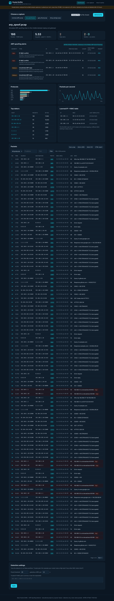
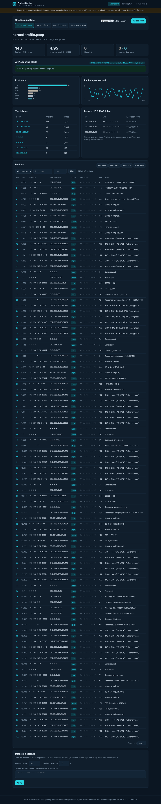
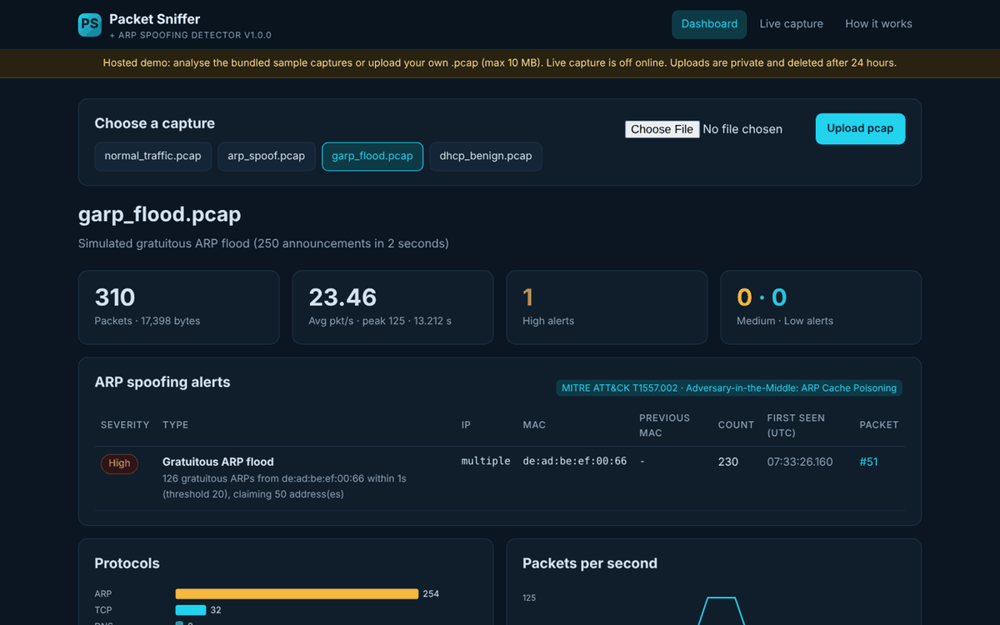
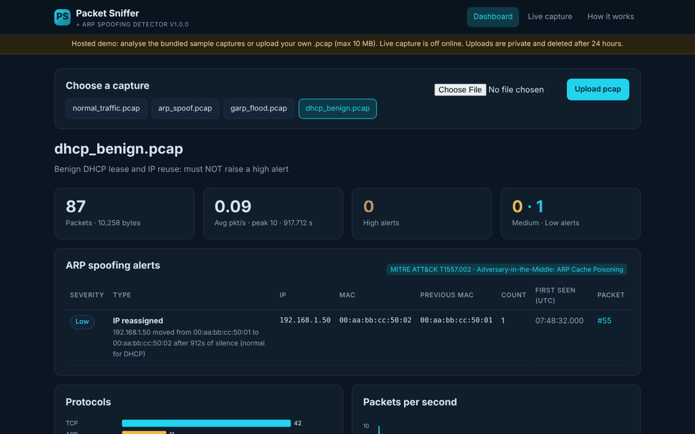
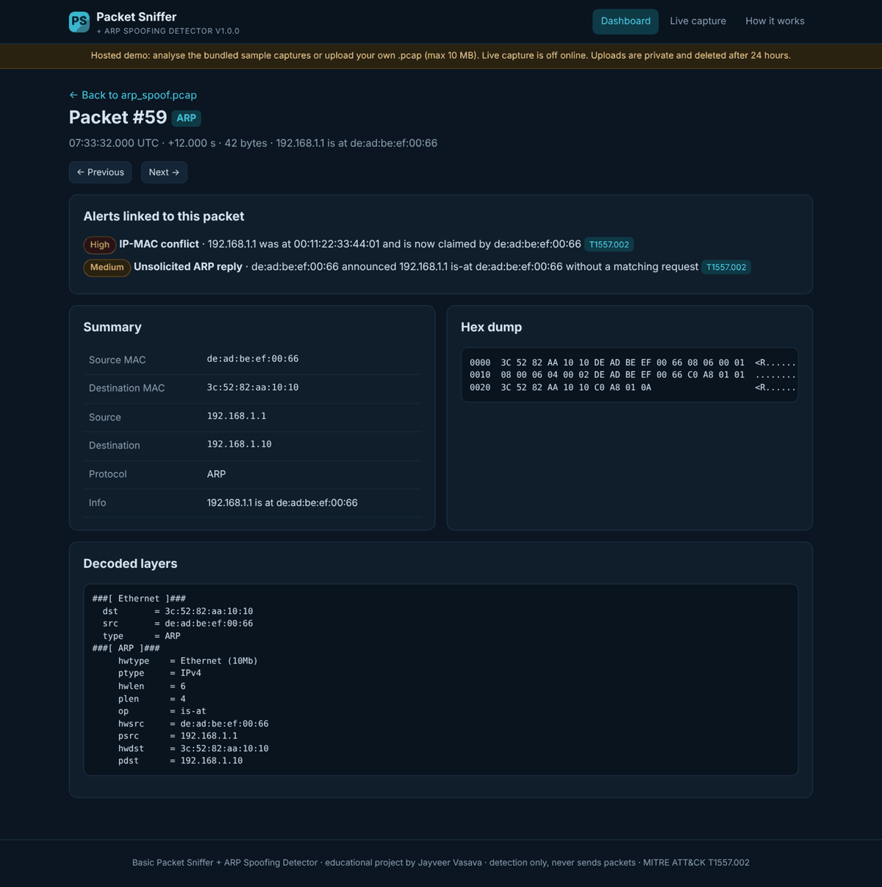
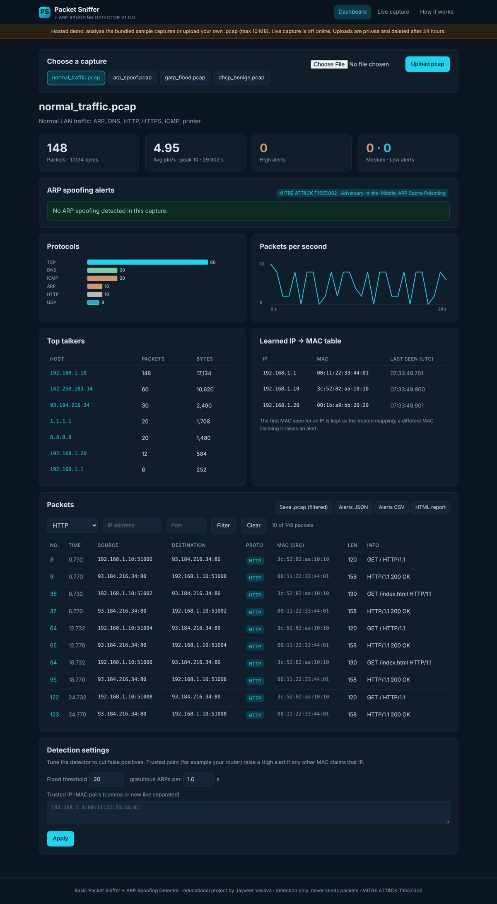
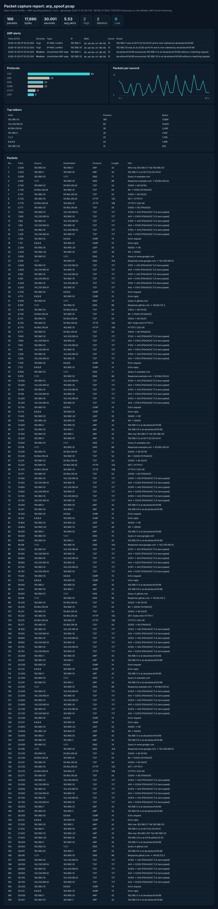
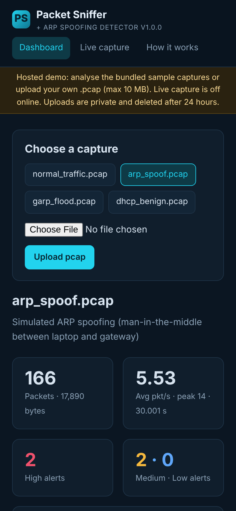
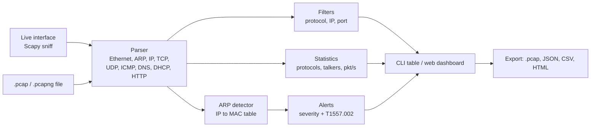

# Basic Packet Sniffer + ARP Spoofing Detector

[](https://github.com/jayveerv/packet-sniffer-arp-detect/actions/workflows/tests.yml)


A Python packet sniffer built on **Scapy** that decodes network traffic and detects **ARP spoofing** (MITRE ATT&CK **T1557.002**, Adversary-in-the-Middle: ARP Cache Poisoning). It reads `.pcap` files or captures live traffic, filters packets, computes statistics, exports `.pcap` / JSON / CSV / HTML, and comes with a **Flask dashboard** that works online with bundled sample captures.

Built as a SkillFied Mentor cyber security internship project by **Jayveer Vasava** (M.Tech Cyber Security, Parul University).

> **Detection only.** This tool never sends, injects or spoofs packets. The spoofing samples were crafted offline with Scapy and written straight to file.

**Live demo:** https://packet-sniffer-arp-detector.onrender.com (free hosting: the first visit after a quiet period can take up to a minute)



---

## Features

| # | Feature | Details |
|---|---|---|
| 1 | Packet capture | Live capture from a network interface (Scapy `sniff`) and reading `.pcap` / `.pcapng` files |
| 2 | Protocol parsing | Ethernet, ARP, IP, IPv6, TCP (flags), UDP, ICMP, DNS (queries and answers), DHCP, HTTP (request / status line), TLS marked as encrypted. Shows time, MACs, IPs, ports, protocol, size and a short summary |
| 3 | Filters | By protocol, IP and port, combinable. `TCP` also matches HTTP, `UDP` also matches DNS and DHCP |
| 4 | ARP spoofing detection | IP&rarr;MAC table, IP-MAC conflicts, gratuitous ARP floods, unsolicited replies, whitelist mismatches; severity levels and MITRE ATT&CK T1557.002 on every alert |
| 5 | False-positive handling | Trusted IP=MAC whitelist, configurable flood threshold and window, DHCP IP reuse treated as Low, ARP probes and single announcements ignored, repeated alerts grouped with a count |
| 6 | Statistics | Protocol counts, top talkers, conversations, packets per second (average, peak, timeline) |
| 7 | Export | Filtered packets as `.pcap`, alerts as JSON and CSV, self-contained HTML report with charts |
| 8 | Command line | `sniff.py` for files, live capture, filters and exports |
| 9 | Web dashboard | Packet table with filters and paging, protocol and packets-per-second charts, alert panel, packet detail (decoded layers + hex dump), pcap upload, detection settings. Works online without live capture |

---

## Screenshots

| ARP spoofing detected | Normal traffic, no alerts |
|---|---|
|  |  |
| **Gratuitous ARP flood** | **Benign DHCP: no high alert** |
|  |  |
| **Packet detail** | **HTTP filter** |
|  |  |
| **HTML report** | **Mobile** |
|  |  |

---

## How it works



### ARP spoofing detection rules

| Alert | Triggered when | Severity |
|---|---|---|
| IP-MAC conflict | An IP that was at one MAC is claimed by a different MAC | High |
| Whitelisted MAC mismatch | A trusted IP (e.g. the router) is claimed by a MAC not in the whitelist | High |
| Gratuitous ARP flood | More than **20** gratuitous ARPs from one MAC within **1 s** (both configurable) | High |
| Unsolicited ARP reply | An "is-at" reply without a matching "who-has" request in the last 2 s | Low, or Medium if it also changes a mapping |
| IP reassigned | A new MAC takes an IP that was silent for more than 300 s (normal DHCP reuse) | Low |

All alerts carry MITRE ATT&CK **T1557.002**. The first MAC seen for an IP is kept as the trusted mapping, so an attacker cannot overwrite it by repeating the lie; repeated alerts are grouped and counted.

### Avoiding false positives

Real networks change IP-MAC mappings for innocent reasons. The detector handles them like this:

- **DHCP renewals and IP reuse**: a different MAC taking an IP that has been silent for 5 minutes is reported as *IP reassigned* (Low), not as an attack.
- **Device announcements**: a single gratuitous ARP after joining the network is normal and never alerts on its own; only bursts above the threshold do.
- **ARP probes** (sender `0.0.0.0`, used by DHCP clients) are ignored.
- **Router failover (VRRP/HSRP), virtual-machine bridges, phone hotspots**: add the expected pairs to the trusted whitelist, or raise the flood threshold, on the dashboard or with `--whitelist` / `--garp-threshold`.

The `dhcp_benign.pcap` sample proves this: it contains a DHCP lease, an announcement and an IP reuse, and produces no High or Medium alert.

---

## Sample captures

Built offline (`python sniff.py --make-samples samples`), nothing was sent on a network. See [samples/README.md](samples/README.md).

| File | Contents | Result |
|---|---|---|
| normal_traffic.pcap | ARP, DNS, HTTP, HTTPS, ICMP, printer traffic | No alerts |
| arp_spoof.pcap | Attacker poisons laptop and gateway (man-in-the-middle) | 2 High + 2 Medium |
| garp_flood.pcap | 250 gratuitous ARPs in 2 s | 1 High flood alert |
| dhcp_benign.pcap | DHCP lease, announcement, IP reuse after 15 min | 1 Low only |

---

## Quick start (Windows)

1. Install **Python 3.10 or newer** from [python.org](https://www.python.org/downloads/) and tick **"Add python.exe to PATH"**.
2. Download this repository (**Code** &rarr; **Download ZIP**) and unzip it.
3. Double-click **`run.bat`**. The first run installs everything, then shows a menu:

```
  1. Open the web dashboard (http://127.0.0.1:5000)
  2. Analyse the ARP spoofing sample
  3. Analyse all samples and write HTML reports to the "reports" folder
  4. Analyse my own .pcap file
  5. List network interfaces
  6. Live capture for 30 seconds (needs Npcap + Administrator)
  7. Run unit tests
```

**Live capture on Windows** needs [Npcap](https://npcap.com) (tick *"WinPcap API-compatible mode"* during setup) and Administrator rights: right-click `run.bat` &rarr; *Run as administrator*. `run.bat` checks both and tells you if something is missing. Without them, everything else works with `.pcap` files.

### Linux / macOS

```bash
./run.sh            # web dashboard
./run.sh demo       # analyse the ARP spoofing sample
./run.sh live eth0  # 30 s live capture (asks for sudo)
./run.sh test       # unit tests
```

---

## Command-line usage

```bash
python sniff.py --make-samples samples                         # build the sample pcaps
python sniff.py --pcap samples/arp_spoof.pcap                  # analyse a file
python sniff.py --pcap samples/normal_traffic.pcap --proto tcp --port 80
python sniff.py --pcap samples/normal_traffic.pcap --ip 1.1.1.1 --limit 0
python sniff.py --pcap capture.pcap --report report.html --alerts-json alerts.json --alerts-csv alerts.csv
python sniff.py --pcap capture.pcap --proto dns --save-pcap dns_only.pcap
python sniff.py --pcap capture.pcap --whitelist 192.168.1.1=00:11:22:33:44:01 --garp-threshold 50
python sniff.py --list-ifaces
python sniff.py --iface "Wi-Fi" --timeout 60 --save-pcap capture.pcap   # live (admin)
```

Exit code is `1` when a High alert is found. Example:

```
   No.       Time  Source                 Destination            Proto   Len  Info
    59     12.000  192.168.1.1            192.168.1.10           ARP      42  192.168.1.1 is at de:ad:be:ef:00:66 <-- High
    60     12.001  192.168.1.10           192.168.1.1            ARP      42  192.168.1.10 is at de:ad:be:ef:00:66 <-- High

166 packets (28 after filters), 17,890 bytes, 30.001 s, avg 5.53 pkt/s, peak 14 pkt/s
Protocols: TCP 80, ARP 28, DNS 20, ICMP 20, HTTP 10, UDP 8

ARP alerts: 4  (High 2, Medium 2, Low 0)  MITRE ATT&CK T1557.002 Adversary-in-the-Middle: ARP Cache Poisoning
  [High  ] IP-MAC conflict: 192.168.1.1 was at 00:11:22:33:44:01 and is now claimed by de:ad:be:ef:00:66 (x10, first at packet 59)
  [High  ] IP-MAC conflict: 192.168.1.10 was at 3c:52:82:aa:10:10 and is now claimed by de:ad:be:ef:00:66 (x10, first at packet 60)
```

---

## Project structure

```
packet-sniffer-arp-detect/
├── pkt/
│   ├── parser.py        # Scapy packet -> readable record
│   ├── filters.py       # protocol / IP / port filters
│   ├── arp_detector.py  # ARP spoofing detection + whitelist
│   ├── stats.py         # protocol counts, top talkers, pkt/s
│   ├── capture.py       # pcap reader, live capture, Npcap/root check
│   ├── analyzer.py      # ties parsing, detection and stats together
│   ├── export.py        # pcap, JSON, CSV, HTML report, SVG charts
│   └── samples.py       # offline sample builder (never sends)
├── samples/             # 4 bundled sample captures
├── webapp/              # Flask dashboard
├── tests/               # 41 unit tests (pytest)
├── sniff.py             # command line
├── run.bat / run.sh     # one-click launchers
├── render.yaml          # Render deployment
└── requirements.txt
```

## Tests

```bash
pip install -r requirements-dev.txt
python -m pytest -q
```

41 tests cover parsing of every protocol, filters, every detection rule (conflict, flood threshold, slow announcements, unsolicited replies, whitelist, DHCP reuse, probes, grouping), all four samples end to end including the benign DHCP case, statistics, every export format (with HTML escaping), the CLI, and the web app (dashboards, filters, paging, packet detail, exports, upload validation, private uploads, settings, live capture disabled online). GitHub Actions runs them on Windows and Linux.

## Deploy on Render

1. Sign in at [render.com](https://render.com) with GitHub.
2. **New +** &rarr; **Blueprint** &rarr; choose this repository (Render reads `render.yaml`) &rarr; **Apply**.
3. Open the `.onrender.com` link when the build finishes.

The hosted demo runs in public mode: live capture is off, uploads are limited to 10 MB, private to each visitor and deleted after 24 hours. The free plan sleeps when idle, so the first visit can take up to a minute.

## Limitations

- Encrypted traffic (HTTPS/TLS) is shown as TLS without content; HTTP is decoded only from the request or status line in a packet (no stream reassembly).
- ARP detection only: no detection of DHCP spoofing, DNS spoofing or IPv6 neighbour spoofing.
- Thresholds are heuristics; very busy or unusual networks may need tuning.
- Live capture needs administrator/root rights and Npcap on Windows.
- Only capture networks you own or are authorised to monitor.

## License

[MIT](LICENSE) &copy; 2026 Jayveer Vasava
